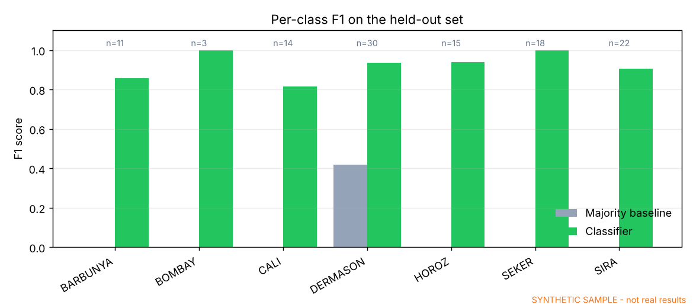
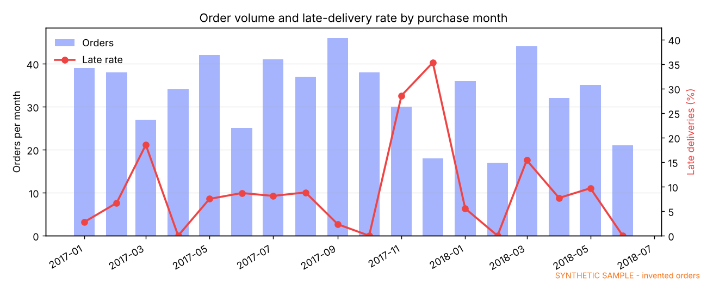

# Dataset Starter Packs

**Ready-to-run NASA, UCI, and Kaggle projects with starter notebooks, data dictionaries, baseline results, and extension challenges.**

Pick a real dataset, run a working notebook, and turn it into your own project. Every pack answers five questions up front:

- **What can I build?** One question, one baseline, one chart worth showing.
- **Where do I get the data?** An official source, a loader that downloads and records provenance, and a dataset card with license and citation.
- **What do the columns mean?** A data dictionary with grain, keys, units, target and columns to exclude.
- **How do I run it?** Sample mode works offline from a fresh clone. Real mode fetches the official data.
- **What can I add next?** Two or three challenges with an outcome you can show.

Each pack also names its dataset's **biggest technical trap**, avoids it in code, and checks it with a regression test.

## Discover: find data by describing your project

The home page is a search over a wider catalog of source-linked datasets. Type what you're building:

> *I need traffic incident data for RouteWatch. It should have latitude, longitude, and timestamps, cover at least one year, and be available as CSV.*

The query becomes **editable requirements**: *Latitude and longitude*, *Timestamp*, *At least 1 year*, *CSV*. You can remove each one or switch it from **Required** to **Preferred**. Every dataset is then checked against its stored source metadata and lands in one group:

| Group | Meaning |
|---|---|
| **Meets requirements** | Every required criterion is supported by verified or publisher-reported evidence |
| **Needs verification** | Nothing rules it out, but at least one requirement isn't confirmed (e.g. *"Date coverage is unverified."*). One click makes it preferred or removes it |
| **Doesn't meet** | The source shows a required criterion isn't satisfied (collapsed, with the reason) |

Each result explains the fit in plain sentences built from the source's own fields, for example *"Latitude and longitude are documented on each record (`latitude`, `longitude`)."* It also shows publisher, provider, observation dates, area, format, access, license and a **View source** link. Curated datasets lead straight into **Run sample**.

- **Evidence model:** every claim is `verified` (checked by a pack loader), `provider-reported` (stated on the publisher's page, with the URL) or `unknown`. Unknown is shown, never guessed.
- **Record-level vs. input coordinates:** an API that *accepts* coordinates (NASA POWER, Open-Meteo) doesn't satisfy "latitude and longitude on each record".
- **Filters:** analysis purpose, data characteristics, required fields, coverage and period, region, resolution, format, access, license, commercial reuse, provider and starter readiness. Groups combine with AND, options inside a group with OR. Desktop shows a filter rail; mobile shows a drawer.
- **Shareable state:** query, requirements, filters and sort live in the URL. Back from a dataset page restores the same results and scroll position.
- **Compare:** shortlist up to three datasets (saved locally, shareable via `/compare?ids=…`) and compare schema, coverage, access, license and missing requirements side by side.
- **Three statuses per dataset:** *source responded*, *metadata reviewed* and *sample ran successfully*, because each answers a different question. The detail page also separates three dates: observation coverage, source last updated, and when this project last verified the metadata.

### Live search: any topic, not just the indexed catalog
Every new query also searches live providers **in parallel**: Hugging Face, Kaggle, DataCite (Zenodo, Figshare, Dryad, Dataverse…), UCI, NASA Earthdata, and a web search API (Brave or Google Programmable Search; add a key in `backend/.env`). A progress strip shows each source as it answers, and results appear as soon as they arrive. A slow or failed provider never blocks the others, cached results are labelled with their age, and "Nothing matches" appears only after every source has finished.

Live results go through the same requirement checks. For **Social media datasets**:
- **TweetEval** (Hugging Face) documents only `text` and a three-class `label`, so selecting **Timestamp** required moves it to *Doesn't meet*.
- **Sentiment140** (Kaggle) has no schema in the search results, so it sits under *Needs verification*.
- The **SNAP Reddit Hyperlink Network** states its unit of analysis: a link between communities.

Web results are re-ranked toward publisher pages and repository dataset cards, blogs and social posts are dropped, and pages that publish schema.org `Dataset` metadata are enriched with license, coverage, formats and downloadable files. Duplicates merge by provider ID, DOI or canonical URL.

**Card actions.** Each Discover card offers one action that matches what can actually run:
- Starter packs: **Run sample**, which opens the pack's own Run tab.
- Datasets you've analyzed: **View run**.
- New datasets with a file the app can read: **Run sample**.
- Datasets that need a sign-in, use an unsupported format (for example NASA's NetCDF granules) or have no usable file: **Open source** plus **Upload**, with a one-line reason. No job starts until there's a readable file.

**Run view for analyzed datasets** (`/datasets/<id>/run`) follows the starter packs' Run screen:
- **Settings on the left:** Sample or Full analysis; the source file or an uploaded one; a date range when the provider can filter server-side (Socrata date columns, sent as a SoQL `$where`).
- **Progress on the right:** Fetching → Profiling → Building charts → Saving, with elapsed time, the log, a **Stop** button and the failure reason. **Retry** appears only for temporary failures (timeouts, network, interrupted). An oversized export offers **Run sample instead**; sign-in and format problems offer **Open source** and **Upload**.
- **Results:** summary tiles (rows analyzed, date range, missing cells, dataset-specific metrics), a *Sample · 1,000 rows* badge, data-quality checks, and a captioned chart grid chosen from the data. NYC collisions get crashes by hour, a borough breakdown and coordinate coverage; household power gets voltage over time and average consumption by hour. Every chart has a table view. Expandable Schema, First rows and Run log sections follow, then notes and provenance.

Opening the Run view shows the latest successful report. A failed or running job never hides it: the page says "Showing the last successful run". Every run is saved in SQLite or Postgres with the source URL, license, version and SHA-256, and the dataset joins **Curated Packs** as an *Analyzed* card. The card's chart is drawn from the saved report.

**Sample vs. full:**
- A sample reads the first 1,000 rows within 60 seconds. Socrata portals are queried with `$limit` and `$order=:id`, plus `count(*)` for the true total.
- Full analysis profiles every fetched row; nothing is sampled. Socrata tables (NYC, Chicago…) are fetched in ordered pages (`$order=:id`, `$limit`/`$offset`, 25,000 rows each), with the selected date range applied to every page and to the row count. Progress shows rows fetched out of the expected total, then Profiling and Building charts as separate steps. A full report is saved only when every page arrived whole, the profiled row count equals the source count, and the count is unchanged at the end. Otherwise the run fails with the reason and the last successful report stays. Paged runs stage up to `DSP_SODA_FULL_MAX_MB` (2 GiB) on disk, deleted after the run; direct files and uploads keep the transfer limit below. Stop works between and within pages. On Vercel, long runs go to the analysis worker (see Deploy).
- Reports are labelled **Sample**, **Full dataset** or **Full selected date range** on the badge, the Curated Packs card and the Run view.
- Rows DuckDB can't parse are counted and reported, not silently dropped.

**Formats, archives and limits.** The file type is detected from its content (signatures and structure), not the extension, and a format registry (`backend/app/discovery/formats/`) picks the analysis:

| Detected | Report |
|---|---|
| CSV, TSV, JSON, Parquet, Excel | Schema, missing values, charts. Tables with `x`/`y`/`z` and a time column also get a trajectory: an orbit projection, state components over time and maneuver markers. A paired metadata file (Hugging Face `state_vectors/` + `metadata/` sharing a `<timestamp>_<pid>` prefix) is analyzed with it. |
| Images (PNG, JPEG, TIFF…) in an archive | Image counts, dimensions, class balance, annotation coverage and preview overlays. Labels come from COCO, YOLO, DOTA, Pascal VOC, LabelMe, a label CSV, `label__scene__lon_lat` file names (Ships in Satellite Imagery) or class folders. |
| SINEX (`.snx`, `.sinex`, `.gz`, `.Z`, or in a ZIP) | Stations, solution epochs, coordinate and velocity estimates with units and uncertainties. Station maps use STAX/STAY/STAZ converted on GRS80, or the approximate SITE/ID positions (labelled); no coordinates, no map. |
| Anything else (NetCDF, HDF5, unknown) | **Inspection only**: detected type, files, sizes and the next useful action. Labelled as such everywhere. |

New handlers subclass `Handler` and call `register()`; Run doesn't change. ZIP members are listed before anything is extracted (and, when the server allows ranged reads, before anything is downloaded: **Look inside before running**). Unsafe paths, symlinks and encrypted entries are skipped; only the files the chosen analysis needs are extracted, and bytes are counted as they are written. Choose members yourself in the inspector.

| Limit | Default | Applies to |
|---|---|---|
| `DSP_MAX_TRANSFER_BYTES` | 2,000,000,000 (2 GB) | Uploads (direct and Blob), provider downloads, ZIPs |
| `DSP_MAX_EXTRACT_BYTES` | 6,000,000,000 | Bytes expanded from archives in one run |
| `DSP_SAMPLE_MAX_MB` | 25 | What a Quick sample may download whole |
| `DSP_CACHE_MAX_BYTES` | 5,000,000,000 | Download cache (least recently used files are evicted first) |
| `DSP_RANGE_FETCH_MAX_SHARE` | 0.5 | Read ZIP members with HTTP ranges only while they are at most this share of the archive |
| `DSP_RANGE_MIN_ARCHIVE_BYTES` | 2,000,000 | Smaller archives are simply downloaded |

**Fetching only what's needed.** When a remote ZIP's server accepts byte ranges, a run reads the central directory and then only the chosen members (one request each, CRC-checked); a 44 KB worksheet inside a 200 MB archive costs about 45 KB. When the server refuses ranges, the Run view says so and how big the one-time download is before you start. Every download and member read goes into a cache under the state directory (`DSP_CACHE=0` turns it off) keyed by provider URL, record version and the server's ETag / Last-Modified / size, scoped to the user for authenticated sources (Kaggle). **Look inside**, samples, full runs and reruns reuse it; a changed ETag or version invalidates it. Partial files are written as `.part` and removed on failure or **Stop**. Each report saves per-stage timings (discovery, probe, listing, ranged fetch or download, extract, profile, charts, save) and the bytes transferred; they're under **Run log and timings**.

**One report layout for every import.** Summary and headline, key-metric tiles, data-quality checks, a balanced grid of charts (pairs; a single leftover chart takes the full row), then Archive contents, Schema, First rows and Run log as collapsed sections that load only when opened. Each chart caption says what it shows, the fields used and the rows included. Tables with a target-like column (melting point, price, label…) get its distribution, a scatter against the most associated field and a signed comparison of Pearson associations (Spearman in the tooltip) when there are at least 30 rows; these are labelled associations, not causes. Units are shown only when the column header states them. Time series get trends and a year-over-year monthly comparison; labelled images get class balance, dimensions and annotation coverage. The scope label is exact: **Full selected worksheet** (with file and sheet; pick another sheet under Settings), **Full dataset** only when the whole intended dataset was read. Reopening a saved report loads a compact version first (rows deferred) and never refetches.

A failure names the limit, its value and the measured (or server-reported) size, with the next action. A ZIP over the Quick sample budget offers **Prepare archive and run sample** (download once, extract only a systematic sample) or **Run full analysis**. Downloads stream to disk with a deadline and an idle timeout, retry temporary failures with a Range resume, honour **Stop** between chunks, extracted files and image batches, and clean up their files after success or failure. Progress shows Fetching (bytes or rows), Inspecting (files extracted), Analyzing (images or rows) and Saving.

**Connect Kaggle.** Settings → Kaggle (or **Connect Kaggle** on a Kaggle dataset's Run view). Log in or sign up first, so the connection and your reports belong to you. Connect with an official Kaggle API token (`KGAT_…`), your `kaggle.json`, or username + key; with a registered Kaggle OAuth client (`KAGGLE_OAUTH_CLIENT_ID`), **Sign in with Kaggle** uses Kaggle's authorization-code flow with PKCE. Tokens are verified with Kaggle, encrypted at rest (`DSP_SECRET_KEY`), sent only in `Authorization` headers, and never returned to the browser, put in URLs or logged. Once connected, the Run view lists the dataset's files plus **Entire dataset (ZIP)**, and **Fetch and analyze** runs like any other source. When Kaggle asks you to accept the dataset's terms, **Accept terms on Kaggle** opens the page; come back and retry, and the selected file is kept in the URL. Reconnect or disconnect from Settings.

**Accounts.** Runs started while signed in are visible only to you (Run view, Discover, Curated Packs, Run history); anonymous runs stay shared. Sessions are an HttpOnly cookie; passwords are hashed with scrypt.

**Starter packs keep their own pages** (Run · Guide · Data dictionary · Dataset card · Challenges · History), with **Run on sample** and **Run on real data**.

**Compare.** **Compare** on any result adds it to a queue of up to three that persists across tabs and refreshes; the nav shows *Compare (n)*. The Compare tab shows source, format, access, license, coverage, required fields and each dataset's latest analysis (or *Analysis pending*). **Save comparison** stores a snapshot with the exact analysis-run ids, so later analyses never rewrite it; saved comparisons are listed under Compare and link to their runs.

**Your session is kept.** The Discover query, requirements, filters and sort live in the URL, and the last Discover and Curated Packs URLs are remembered for the browser session, so the nav takes you back to them. Results, live-source status and scroll position are cached per URL in `sessionStorage` and refresh in the background. **Clear search** and **Clear queue** are separate. The Light / Dark / System theme (top-right menu) is stored in `localStorage` and applied before first paint.

### Troubleshooting: "Searching 0 records"
If Discover says the local catalog is empty, the API didn't find `catalog/records/` (or `packs/`) next to `backend/`. This usually happens when only some folders were copied into an existing checkout. The banner shows the exact paths it checked. Packs are still indexed from their `pack.json` as a fallback, and live sources keep working.

### Where the catalog comes from
- `catalog/records/*.json`: reviewed, versioned records (the five packs + source-linked external datasets such as NYC and Chicago crash data, UK STATS19, US Accidents, UCI time series, Open-Meteo and GPM IMERG). Indexed into SQLite FTS5 (BM25) at startup.
- **Live search results** are indexed as *Live result* records (unreviewed) with the query that found them.
- **Provider imports** (UCI API, Kaggle dataset search, NASA Earthdata CMR) run on demand or on a schedule (`DSP_IMPORT_INTERVAL_HOURS`). They're deduplicated by id and source URL and labelled *Unreviewed import* until promoted. Each source has its own timeout and status. If one provider is down, everything already indexed stays searchable and the outage is shown.
- `catalog/benchmark.json`: purpose-based queries with expected matches and tempting results that must *not* be confirmed. `python scripts/search_benchmark.py` reports the top-5 hit rate and hard-filter violations (CI fails on any violation).

## The packs

<!-- catalog:start -->
| Preview | Pack | What you'll build | Level | Links |
|---|---|---|---|---|
|  | **Bike Demand Forecast**<br>UCI · Regression · time series | Predict next-hour bike rentals and beat a historical baseline without leaking the answer.<br>**Trap:** casual + registered = cnt | beginner<br>45 minutes | [Open notebook](packs/uci-bike-demand/starter.ipynb)<br>[Download starter](../../releases/latest/download/uci-bike-demand-starter.zip)<br>[View dataset](https://archive.ics.uci.edu/dataset/275/bike+sharing+dataset) |
|  | **Bengaluru Weather Explorer**<br>NASA · Time series · live API | Pull daily NASA POWER weather from a live API, chart the monsoon, and set a next-day forecast baseline.<br>**Trap:** -999 is not a temperature | beginner<br>40 minutes | [Open notebook](packs/nasa-bengaluru-weather/starter.ipynb)<br>[Download starter](../../releases/latest/download/nasa-bengaluru-weather-starter.zip)<br>[View dataset](https://power.larc.nasa.gov/docs/services/api/temporal/daily/) |
|  | **Exoplanet Discovery Explorer**<br>NASA · Astronomy · exploratory analysis | Query the NASA Exoplanet Archive live and see how each discovery method shapes the catalog.<br>**Trap:** A catalog is not a census | intermediate<br>50 minutes | [Open notebook](packs/nasa-exoplanets/starter.ipynb)<br>[Download starter](../../releases/latest/download/nasa-exoplanets-starter.zip)<br>[View dataset](https://exoplanetarchive.ipac.caltech.edu/docs/pscp_about.html) |
|  | **Dry Bean Classifier**<br>UCI · Multiclass classification | Classify seven bean varieties from image-derived shape features - and see what accuracy hides.<br>**Trap:** Accuracy can hide a failing class | beginner<br>40 minutes | [Open notebook](packs/uci-dry-bean/starter.ipynb)<br>[Download starter](../../releases/latest/download/uci-dry-bean-starter.zip)<br>[View dataset](https://archive.ics.uci.edu/dataset/602/dry+bean+dataset) |
|  | **E-Commerce Delivery Analytics**<br>Kaggle · SQL analytics | Use DuckDB SQL on 100k Brazilian orders to measure late deliveries - without inflating your KPIs.<br>**Trap:** Rows are not orders | intermediate<br>60 minutes | [Open notebook](packs/kaggle-olist-delivery/starter.ipynb)<br>[Download starter](../../releases/latest/download/kaggle-olist-delivery-starter.zip)<br>[View dataset](https://www.kaggle.com/datasets/olistbr/brazilian-ecommerce) |
<!-- catalog:end -->

Preview charts come from the **synthetic sample** and are labelled as such. Run real mode to get real results.

## Quick start

You need **Python 3.12+** and **Node.js 20+** (for the web app only).

### Option A: the web app (browse, run, compare results)

**Linux / macOS**
```bash
git clone https://github.com/<you>/dataset-starter-packs.git
cd dataset-starter-packs
./dev.sh            # first run creates backend/.venv and installs everything
```

**Windows PowerShell**
```powershell
git clone https://github.com/<you>/dataset-starter-packs.git
cd dataset-starter-packs
.\dev.ps1
```

Open **http://127.0.0.1:5173**: Discover is the home page and Curated packs is one click away. The API and its interactive docs are at http://127.0.0.1:8000/docs.
To serve everything from one port instead (no hot reload): `./dev.sh --single` or `.\dev.ps1 -Single`, then open http://127.0.0.1:8000.

<details>
<summary>Manual start (two terminals)</summary>

```bash
# Terminal 1 - API
cd backend
python -m venv .venv
source .venv/bin/activate            # Windows: .\.venv\Scripts\Activate.ps1
pip install -r requirements.txt
uvicorn app.main:app --reload --port 8000

# Terminal 2 - web app
cd frontend
npm ci
npm run dev
```
</details>

### Option B: one pack, no web app

```bash
cd packs/uci-bike-demand
python -m venv .venv && source .venv/bin/activate     # Windows: py -3.12 -m venv .venv; .\.venv\Scripts\Activate.ps1
pip install -r requirements.txt
python analysis.py --mode sample      # offline, seconds
python analysis.py --mode real        # downloads the official data once
jupyter lab starter.ipynb
```

Each pack folder is self-contained. You can copy it anywhere, or download its starter ZIP, and it still runs.

## How it fits together

```
dataset-starter-packs/
├── packs/<slug>/          self-contained projects (pack.json is the single source of truth)
│   ├── pack.json          metadata: provider, skills, source, license, parameters, challenges
│   ├── load_data.py       sample + real loaders, timeouts, cache, provenance in data/raw/source.json
│   ├── analysis.py        the notebook's steps as a CLI -> results.json + PNG charts
│   ├── starter.ipynb      load -> validate -> explore -> baseline -> evaluate -> limitations
│   ├── data-dictionary.md
│   ├── fixtures/          synthetic data with the real schema and deliberate tricky cases
│   └── tests/             schema + the pack's signature trap
├── catalog/               reviewed dataset records, import queries, search benchmark
├── backend/               FastAPI: discovery search, provider imports, pack runs (subprocess), uploads, ZIPs, source checks
├── frontend/              React + Vite + TypeScript + Tailwind
├── pack-template/         copy this to add a pack
├── scripts/               validate_catalog, run_pack_tests, package_starters, check_sources
└── .github/workflows/     ci.yml (PRs), source-check.yml (weekly), release.yml (ZIPs on tags)
```

The web app runs packs exactly as you would in a terminal: `python analysis.py --mode … --out …` in the pack folder, as a separate process. The result you see in the browser is the same one the CLI and the notebook produce. Run history is kept in `backend/.state/` (SQLite + run folders).

## Sample mode vs. real mode

| | Sample (default) | Real |
|---|---|---|
| Data | `fixtures/`: small, invented, real schema | Official source, cached in `data/raw/` |
| Network | Not needed | NASA API / UCI download / Kaggle ZIP you provide |
| Results | Watermarked **SYNTHETIC SAMPLE** | Real numbers + provenance (URL, retrieval date, checksum or query) |

The Olist dataset needs a free Kaggle sign-in and can't be redistributed. Download `archive.zip` from Kaggle, then upload it on the pack page or run `python load_data.py --import archive.zip`.

## Development

```bash
pip install -r backend/requirements.txt
ruff check .
python scripts/validate_catalog.py            # packs + catalog records + README catalog (use --write to regenerate)
python scripts/search_benchmark.py            # search quality: top-5 hits, hard-filter violations
python scripts/run_pack_tests.py --isolated --notebooks
cd backend && python -m pytest -q tests
cd frontend && npm run build
python scripts/package_starters.py            # dist/<slug>-starter.zip
python scripts/check_sources.py               # are NASA / UCI / Kaggle reachable?
```

## Star, fork, or use as a template

- **Star** it to keep a verified dataset and project brief you can come back to.
- **Fork** it to contribute upstream. Good first issues: improving a data dictionary, adding a tricky fixture, verifying Windows setup.
- **Use this template** for your own independent collection (it gets a fresh history).
- **Download one starter ZIP** from Releases to start a portfolio project from a single pack.

Code: MIT. Datasets keep their own licenses; see [DATA_SOURCES.md](DATA_SOURCES.md).

## Deploy

### Docker (local or any server)

```bash
cp .env.example .env        # optional: provider keys, DATABASE_URL, limits
docker compose up -d --build
# open http://localhost:8000
```

One image serves the API and the built React app on port 8000. `docker compose --profile worker up -d --build` adds a separate analysis worker (`DSP_RUN_MODE=queue`) for long 2 GB runs. Analyses, saved comparisons, curated records, pack-run history and downloaded pack data live on the named volume `dsp-data`, so they survive `docker compose down` and container recreation (`docker compose down -v` deletes them). Starter-pack runs work in the container.

### Vercel

1. Import the repository in Vercel. `vercel.json` and the `[project]` / `[tool.vercel]` sections of `pyproject.toml` configure it: the React app is built by `buildCommand`, and FastAPI (`backend.app.main:app`) runs as one Python function (300 s max duration).
2. Add **Neon Postgres** from the Vercel Marketplace (sets `DATABASE_URL`). Analyses, comparisons, overlays and curated records are stored there; without it they would be lost on every cold start.
3. Connect a **Vercel Blob** store (sets `BLOB_READ_WRITE_TOKEN`). Uploads then go from the browser straight to private Blob storage with authorized multipart uploads (the upload token caps the object at `DSP_MAX_TRANSFER_BYTES`), so they never pass through the function request body. Without Blob, uploads go to the function directly and are capped at 95 MB (Vercel's function request-body limit is 100 MB).
4. Set `DSP_SECRET_KEY` (encrypts connected Kaggle accounts) and, for Kaggle OAuth, `DSP_PUBLIC_URL`.
5. Run the **worker** somewhere with disk and time (any VM or container service). On Vercel the API runs in `DSP_RUN_MODE=queue`: it only records jobs in Postgres, and the worker runs both dataset analyses and starter-pack runs. Until a worker is connected the Run view says so ("Waiting for a worker: none is connected") instead of sitting on "Queued".

   ```bash
   docker compose build app                         # the image holds the API, packs and analysis stack
   docker compose --profile worker up -d --no-deps worker
   # or, without Docker, from backend/:
   python -m app.worker
   python -m app.worker --doctor                    # checks database, Blob, secret key, packs; prints no secrets; exit 1 on a problem
   ```

   Required environment (names only, set the **same values** as in Vercel Production): `DATABASE_URL` (the Neon connection string), `DSP_SECRET_KEY`, `BLOB_READ_WRITE_TOKEN`. `DSP_RUN_MODE=queue` is implied. Optional: `DSP_WORKER_NAME`, `DSP_WORKER_POLL_SECONDS` (2), `DSP_WORKER_HEARTBEAT_SECONDS` (5), `DSP_WORKER_STALE_SECONDS` (30), `DSP_QUEUE_MAX_AGE_HOURS` (24), `DSP_MAX_ARTIFACT_MB` (25 per run).
   Check the wiring from the deployed site: `GET /api/worker/status` (online/busy/offline/none) and `GET /api/diagnostics?deep=1` (Blob token present and accepted, database id, worker mismatches reported as warnings naming the variable). Both return fingerprints, never values. A worker whose heartbeat stops is reported offline after `DSP_WORKER_STALE_SECONDS`; its running job goes back in line (twice at most) and queued jobs wait for it for up to `DSP_QUEUE_MAX_AGE_HOURS`, then fail with the reason.
6. Optional: provider keys from `.env.example`.

Starter-pack runs on Vercel are executed by the worker too (the function never runs the ML stack). Status, log, `results.json` and every chart are stored in Postgres (each run's files up to `DSP_MAX_ARTIFACT_MB`), so the Run view and its charts reload after a refresh from any instance. With no `DATABASE_URL` pack runs stay off and the pack pages offer the starter and notebook downloads.
