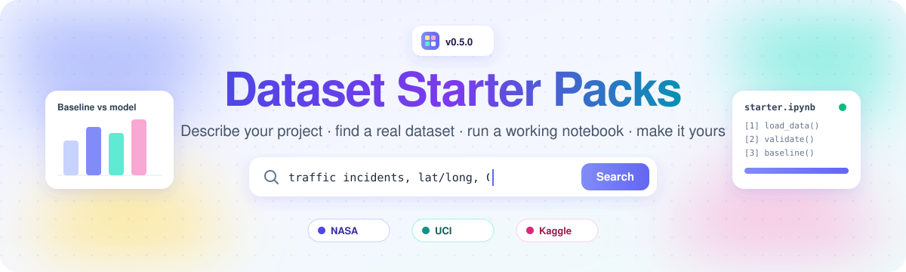
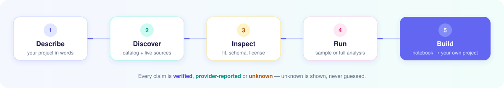
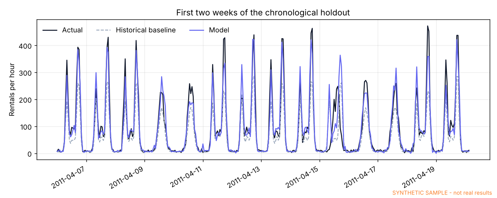
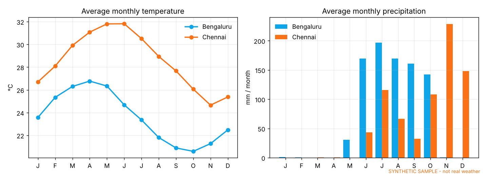
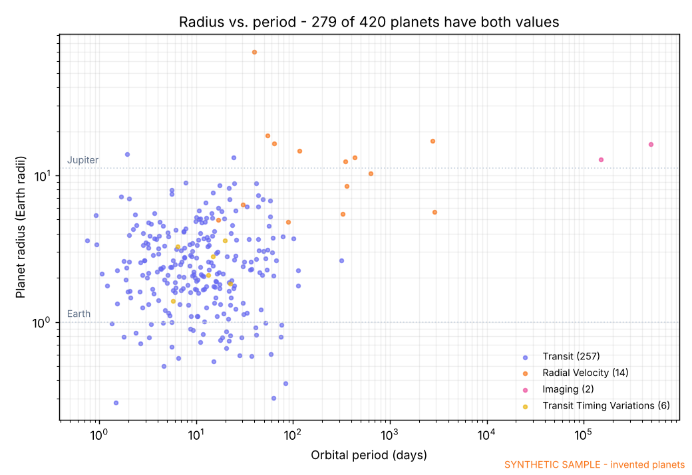
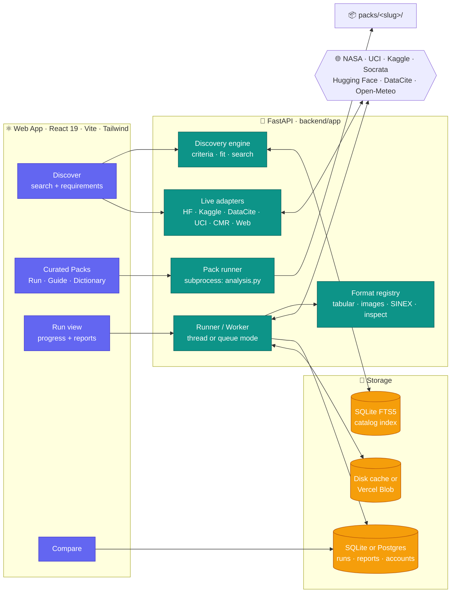
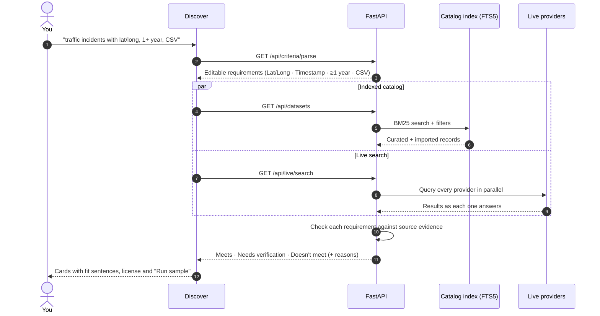
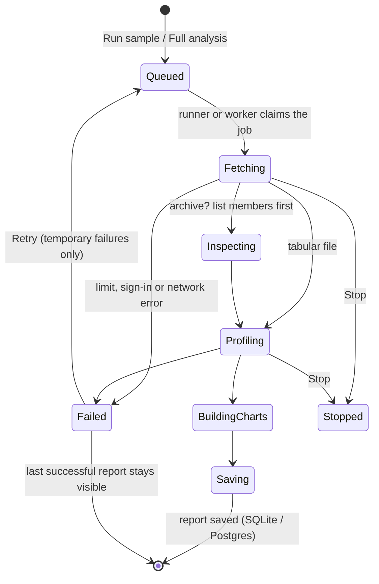
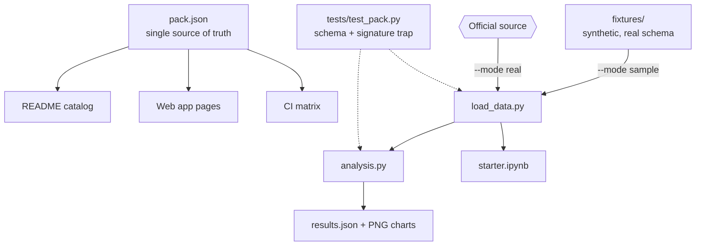
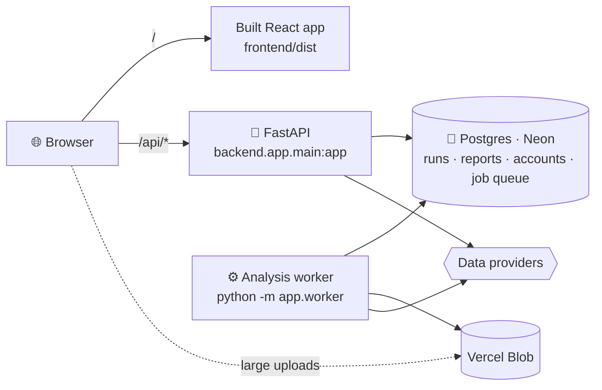

<div align="center">



<a href="https://dataset-starter-packs.vercel.app">
  
</a>

<br/>


<br/>


<br/>


<br> 

[**🌐 Live Demo**](https://dataset-starter-packs.vercel.app) &nbsp;·&nbsp;
[**⚡ Quick Start**](#-quick-start) &nbsp;·&nbsp;
[**📦 The Packs**](#-the-starter-packs) &nbsp;·&nbsp;
[**🏗️ Architecture**](#️-architecture) &nbsp;·&nbsp;
[**🚀 Deploy**](#-deploy) &nbsp;·&nbsp;
[**🛠️ Troubleshooting**](#️-troubleshooting)

</div>


## 🧭 About

**Dataset Starter Packs** helps you go from *"I need data for my project"* to a working, honest analysis in minutes.

Type what you're building — *"traffic incident data with latitude, longitude and timestamps, at least one year, CSV"* — and the app turns it into **editable requirements**, checks every dataset against its real source metadata, and tells you in plain sentences **why** it fits or doesn't. Pick one, run a **sample or full analysis** in the browser, or start from one of the **curated starter packs**: self-contained NASA, UCI and Kaggle projects with a notebook, a data dictionary, a baseline and extension challenges.

<div align="center">
  
</div>

Every starter pack answers five questions up front:

| ❓ Question | ✅ What the pack gives you |
| :--- | :--- |
| **What can I build?** | One question, one baseline, one chart worth showing |
| **Where do I get the data?** | An official source, a loader that records provenance, and a dataset card with license and citation |
| **What do the columns mean?** | A data dictionary with grain, keys, units, target and columns to exclude |
| **How do I run it?** | **Sample mode** works offline from a fresh clone; **real mode** fetches the official data |
| **What can I add next?** | Two or three challenges, each with an outcome you can show |

> [!TIP]
> Each pack also names its dataset's **biggest technical trap** (leakage, sentinel values, row-vs-order grain…), avoids it in code, and guards it with a regression test.


## ✨ Features

<table>
<tr>
<td width="33%" valign="top">

### 🔎 Requirement-based Discover
Describe your project in words. Requirements become chips you can edit, remove, or switch between **Required** and **Preferred**.

</td>
<td width="33%" valign="top">

### 🧾 Evidence, not guesses
Every claim is `verified`, `provider-reported` (with the URL) or `unknown`. Results land in **Meets / Needs verification / Doesn't meet**.

</td>
<td width="33%" valign="top">

### 🌍 Live multi-source search
Hugging Face, Kaggle, DataCite (Zenodo, Figshare, Dryad…), UCI, NASA Earthdata and web search — **in parallel**, with live progress.

</td>
</tr>
<tr>
<td valign="top">

### ▶️ Run in the browser
**Sample** (first 1,000 rows, ≤ 60 s) or **Full analysis** with progress, Stop, Retry, logs and per-stage timings.

</td>
<td valign="top">

### 📊 Auto-generated reports
Summary tiles, data-quality checks, captioned charts with table views, schema, first rows and provenance (URL, license, SHA-256).

</td>
<td valign="top">

### 🗂️ Smart formats
CSV, TSV, JSON, Parquet, Excel, labelled image archives (COCO, YOLO, VOC…), SINEX geodesy files — detected by **content**, not extension.

</td>
</tr>
<tr>
<td valign="top">

### ⚖️ Compare &amp; shortlist
Queue up to three datasets and compare schema, coverage, access, license and missing requirements side by side. Save snapshots.

</td>
<td valign="top">

### 🔐 Accounts &amp; Kaggle connect
Private runs per user, scrypt-hashed passwords, encrypted Kaggle tokens (or **Sign in with Kaggle** via OAuth + PKCE).

</td>
<td valign="top">

### 📦 Curated starter packs
Five self-contained projects with notebooks, fixtures, tests and downloadable starter ZIPs — they run anywhere, even outside the repo.

</td>
</tr>
</table>


## 📦 The Starter Packs

<!-- catalog:start -->
| Preview | Pack | What you'll build | Level | Links |
|---|---|---|---|---|
|  | **Bike Demand Forecast**<br>UCI · Regression · time series | Predict next-hour bike rentals and beat a historical baseline without leaking the answer.<br>**Trap:** casual + registered = cnt | beginner<br>45 minutes | [Open notebook](packs/uci-bike-demand/starter.ipynb)<br>[Download starter](../../releases/latest/download/uci-bike-demand-starter.zip)<br>[View dataset](https://archive.ics.uci.edu/dataset/275/bike+sharing+dataset) |
|  | **Bengaluru Weather Explorer**<br>NASA · Time series · live API | Pull daily NASA POWER weather from a live API, chart the monsoon, and set a next-day forecast baseline.<br>**Trap:** -999 is not a temperature | beginner<br>40 minutes | [Open notebook](packs/nasa-bengaluru-weather/starter.ipynb)<br>[Download starter](../../releases/latest/download/nasa-bengaluru-weather-starter.zip)<br>[View dataset](https://power.larc.nasa.gov/docs/services/api/temporal/daily/) |
|  | **Exoplanet Discovery Explorer**<br>NASA · Astronomy · exploratory analysis | Query the NASA Exoplanet Archive live and see how each discovery method shapes the catalog.<br>**Trap:** A catalog is not a census | intermediate<br>50 minutes | [Open notebook](packs/nasa-exoplanets/starter.ipynb)<br>[Download starter](../../releases/latest/download/nasa-exoplanets-starter.zip)<br>[View dataset](https://exoplanetarchive.ipac.caltech.edu/docs/pscp_about.html) |
|  | **Dry Bean Classifier**<br>UCI · Multiclass classification | Classify seven bean varieties from image-derived shape features - and see what accuracy hides.<br>**Trap:** Accuracy can hide a failing class | beginner<br>40 minutes | [Open notebook](packs/uci-dry-bean/starter.ipynb)<br>[Download starter](../../releases/latest/download/uci-dry-bean-starter.zip)<br>[View dataset](https://archive.ics.uci.edu/dataset/602/dry+bean+dataset) |
|  | **E-Commerce Delivery Analytics**<br>Kaggle · SQL analytics | Use DuckDB SQL on 100k Brazilian orders to measure late deliveries - without inflating your KPIs.<br>**Trap:** Rows are not orders | intermediate<br>60 minutes | [Open notebook](packs/kaggle-olist-delivery/starter.ipynb)<br>[Download starter](../../releases/latest/download/kaggle-olist-delivery-starter.zip)<br>[View dataset](https://www.kaggle.com/datasets/olistbr/brazilian-ecommerce) |
<!-- catalog:end -->

> [!NOTE]
> Preview charts come from the **synthetic sample** and are labelled as such. Run real mode to get real results. This table is generated from each `pack.json` — regenerate it with `python scripts/validate_catalog.py --write`.


## 🏗️ Architecture



### 🔍 From a sentence to ranked, explained results



### ▶️ Lifecycle of an analysis run



### 📁 Anatomy of a starter pack




## 🧰 Tech Stack

| Layer | Technology | Role |
| :--- | :--- | :--- |
| **Frontend** |    | SPA with Discover, Curated Packs, Run view, Compare, Settings |
| **Styling & motion** |    | Light-first UI, Light/Dark/System theme, animations, icons |
| **Routing & content** |   | URL-driven search state, pack guides rendered from Markdown |
| **API** |   | REST API + interactive docs at `/docs`; serves the built SPA |
| **Analysis engine** |    | Profiling, charts, image-archive and SINEX analysis |
| **Starter packs** |     | Baselines, charts, notebooks, Kaggle downloads |
| **Search** | -003B57?logo=sqlite&logoColor=white) | Full-text index over curated records, imports and live results |
| **Storage** |  -4169E1?logo=postgresql&logoColor=white)  | Runs, reports, accounts, comparisons; large uploads |
| **Security** |  | Encrypted provider tokens, hashed passwords, HttpOnly sessions |
| **Data sources** |     | Curated + live provider adapters (also DataCite, Socrata, Open-Meteo) |
| **Deploy** |   | One-image Docker + optional worker; Vercel Python function |
| **Quality** |    | 80+ API tests, per-pack tests, notebook runs, search benchmark (Ubuntu + Windows) |

## 🗂️ Project Structure

```text
Dataset-Starter-Packs/
├── packs/<slug>/              📦 self-contained projects (copy anywhere, they still run)
│   ├── pack.json              metadata: provider, skills, source, license, parameters, challenges
│   ├── load_data.py           sample + real loaders, timeouts, cache, provenance (data/raw/source.json)
│   ├── analysis.py            notebook steps as a CLI → results.json + PNG charts
│   ├── starter.ipynb          load → validate → explore → baseline → evaluate → limitations
│   ├── data-dictionary.md     grain, keys, units, target, columns to exclude
│   ├── fixtures/              synthetic data with the real schema + deliberate tricky cases
│   └── tests/                 schema tests + the pack's signature-trap regression test
├── catalog/
│   ├── records/*.json         🧾 reviewed, versioned dataset records (indexed into FTS5 at startup)
│   ├── import_queries.json    provider import queries
│   └── benchmark.json         search-quality benchmark (CI fails on hard-filter violations)
├── backend/                   🐍 FastAPI app
│   ├── app/main.py            API routes + SPA serving
│   ├── app/discovery/         search, fit checks, live adapters, formats, analysis, cache
│   ├── app/worker.py          queue-mode analysis worker
│   ├── tests/                 pytest suite
│   └── requirements*.txt      full / API-only / packs-only dependency sets
├── frontend/                  ⚛️ React + Vite + TypeScript + Tailwind
│   └── src/pages/             Landing, Discover, CuratedPacks, PackPage, DatasetRunPage, ComparePage…
├── pack-template/             🧩 copy this to add a pack
├── scripts/                   validate_catalog · run_pack_tests · package_starters · check_sources · search_benchmark
├── docker/ · Dockerfile · compose.yaml       🐳 one-image deploy (+ optional worker profile)
├── vercel.json · pyproject.toml              ▲ Vercel config
├── dev.sh · dev.ps1                          🚀 one-command local start
└── .github/workflows/         ci.yml (PRs) · source-check.yml (weekly) · release.yml (ZIPs on tags)
```


## ⚡ Quick Start

### ✅ Prerequisites

| Requirement | Version | Needed for | Check with |
| :--- | :--- | :--- | :--- |
| Python | **3.12+** | API, analysis engine, starter packs | `python --version` |
| Node.js | **20+** (22 recommended) | The web app only | `node --version` |
| npm | comes with Node | Frontend dependencies | `npm --version` |
| Git | any recent | Cloning the repo | `git --version` |
| Docker *(optional)* | Compose v2 | One-command container run | `docker compose version` |

### 1️⃣ Clone the repository

```bash
git clone https://github.com/LoganthP/Dataset-Starter-Packs.git
cd Dataset-Starter-Packs
```

### 2️⃣ Start everything with one command

The first run creates `backend/.venv`, installs Python and Node dependencies (a few minutes), then starts the **API on :8000** and the **web app on :5173** with hot reload.

<details open>
<summary><b>🍎 macOS / 🐧 Linux</b></summary>

```bash
chmod +x dev.sh      # first time only
./dev.sh
```
</details>

<details open>
<summary><b>🪟 Windows (PowerShell)</b></summary>

```powershell
.\dev.ps1
```

If PowerShell blocks the script, allow local scripts once and try again:

```powershell
Set-ExecutionPolicy -Scope CurrentUser RemoteSigned
```
</details>

### 3️⃣ Open the app

| What | URL |
| :--- | :--- |
| 🖥️ **Web app** (Discover is the home page) | **http://127.0.0.1:5173** |
| 📘 **API docs** (Swagger UI) | http://127.0.0.1:8000/docs |
| 💓 **Health check** | http://127.0.0.1:8000/api/health |

Press <kbd>Ctrl</kbd> + <kbd>C</kbd> to stop both servers.

> [!TIP]
> **Single-port mode (no hot reload):** build the frontend once and serve everything from the API —
> `./dev.sh --single` or `.\dev.ps1 -Single`, then open **http://127.0.0.1:8000**.

<details>
<summary><b>🔧 Manual start (two terminals)</b></summary>

**Terminal 1 — API**

```bash
cd backend
python -m venv .venv
source .venv/bin/activate              # Windows: .\.venv\Scripts\Activate.ps1
pip install -r requirements.txt
uvicorn app.main:app --reload --port 8000
```

**Terminal 2 — web app**

```bash
cd frontend
npm ci
npm run dev
```

Then open http://127.0.0.1:5173. The Vite dev server proxies `/api` to port 8000.
</details>

### 4️⃣ Configure optional keys

Everything works without keys. Add them to unlock more live sources:

```bash
cp backend/.env.example backend/.env       # Windows: Copy-Item backend\.env.example backend\.env
```

```env
# Web search for dataset landing pages (set ONE)
BRAVE_SEARCH_API_KEY=
# GOOGLE_CSE_KEY=
# GOOGLE_CSE_CX=

# Higher Hugging Face rate limits
HF_TOKEN=

# Server-side Kaggle fallback (users normally connect their own account in Settings → Kaggle)
KAGGLE_USERNAME=
KAGGLE_KEY=

# Show "Open on GitHub" links
DSP_GITHUB_REPO=LoganthP/Dataset-Starter-Packs
```

Restart `./dev.sh` after editing `.env`.

### 5️⃣ Run a single pack — no web app needed

Every pack folder is self-contained. Copy it anywhere (or download its starter ZIP from Releases) and it still runs.

<details open>
<summary><b>🍎 macOS / 🐧 Linux</b></summary>

```bash
cd packs/uci-bike-demand
python3 -m venv .venv && source .venv/bin/activate
pip install -r requirements.txt

python analysis.py --mode sample       # offline, a few seconds
python analysis.py --mode real         # downloads the official data once
jupyter lab starter.ipynb              # open the guided notebook
```
</details>

<details>
<summary><b>🪟 Windows (PowerShell)</b></summary>

```powershell
cd packs\uci-bike-demand
py -3.12 -m venv .venv
.\.venv\Scripts\Activate.ps1
pip install -r requirements.txt

python analysis.py --mode sample
python analysis.py --mode real
jupyter lab starter.ipynb
```
</details>

Loader commands (inside any pack folder):

```bash
python load_data.py --fetch            # download the real dataset into data/raw/
python load_data.py --fetch --force    # re-download even if cached (NASA / UCI packs)
python -m pytest -q tests              # run the pack's own tests
```

> [!IMPORTANT]
> **Olist (Kaggle) can't be redistributed.** Download `archive.zip` from [Kaggle](https://www.kaggle.com/datasets/olistbr/brazilian-ecommerce) (free sign-in), then either upload it on the pack page or run:
> `cd packs/kaggle-olist-delivery && python load_data.py --import archive.zip`

### 🔀 Sample mode vs. real mode

| | 🧪 Sample (default) | 🌐 Real |
| :--- | :--- | :--- |
| **Data** | `fixtures/`: small, invented, real schema | Official source, cached in `data/raw/` |
| **Network** | Not needed | NASA API / UCI download / Kaggle ZIP you provide |
| **Results** | Watermarked **SYNTHETIC SAMPLE** | Real numbers + provenance (URL, retrieval date, checksum or query) |


## 🔎 How Discover Works

Type what you're building, and the query becomes requirements you can edit. Every dataset is then checked against its stored source metadata and placed in one group:

| Group | Meaning |
| :--- | :--- |
| 🟢 **Meets requirements** | Every required criterion is supported by verified or publisher-reported evidence |
| 🟡 **Needs verification** | Nothing rules it out, but at least one requirement isn't confirmed (e.g. *"Date coverage is unverified."*) |
| 🔴 **Doesn't meet** | The source shows a required criterion isn't satisfied (collapsed, with the reason) |

Each card explains the fit in plain sentences built from the source's own fields — e.g. *"Latitude and longitude are documented on each record (`latitude`, `longitude`)."* — plus publisher, coverage, area, format, access, license and a **View source** link.

<details>
<summary><b>🧾 Evidence model &amp; search rules</b></summary>

- **Evidence:** every claim is `verified` (checked by a pack loader), `provider-reported` (stated on the publisher's page, with the URL) or `unknown`. Unknown is shown, never guessed.
- **Record-level vs. input coordinates:** an API that *accepts* coordinates (NASA POWER, Open-Meteo) doesn't satisfy "latitude and longitude on each record".
- **Filters:** purpose, data characteristics, required fields, coverage and period, region, resolution, format, access, license, commercial reuse, provider and starter readiness. Groups combine with AND, options inside a group with OR.
- **Shareable state:** query, requirements, filters and sort live in the URL; Back restores results and scroll position.
- **Three statuses per dataset:** *source responded*, *metadata reviewed* and *sample ran successfully*.
- **Three dates per dataset:** observation coverage, source last updated, and when this project last verified the metadata.
</details>

<details>
<summary><b>🌍 Live search providers</b></summary>

Every new query also searches live providers **in parallel**: Hugging Face, Kaggle, DataCite (Zenodo, Figshare, Dryad, Dataverse…), UCI, NASA Earthdata, and a web search API (Brave or Google Programmable Search). A progress strip shows each source as it answers. A slow or failed provider never blocks the others, cached results are labelled with their age, and "Nothing matches" appears only after every source has finished.

Web results are re-ranked toward publisher pages and repository dataset cards; blogs and social posts are dropped; pages that publish schema.org `Dataset` metadata are enriched with license, coverage, formats and files. Duplicates merge by provider ID, DOI or canonical URL.
</details>

<details>
<summary><b>▶️ Sample vs. full analysis in the Run view</b></summary>

- **Sample:** reads the first 1,000 rows within 60 seconds. Socrata portals are queried with `$limit` and `$order=:id`, plus `count(*)` for the true total.
- **Full analysis:** profiles every fetched row. Socrata tables are fetched in ordered pages of 25,000 rows with the selected date range applied. A full report is saved only when every page arrived whole and the row count matches the source; otherwise the run fails with the reason and the last successful report stays.
- Reports are labelled **Sample**, **Full dataset** or **Full selected date range**.
- Rows DuckDB can't parse are counted and reported, never silently dropped.
- Remote ZIPs that accept byte ranges are read member-by-member (a 44 KB worksheet inside a 200 MB archive costs ≈ 45 KB). Downloads are cached by URL, version and ETag.
</details>

<details>
<summary><b>🗂️ Supported formats</b></summary>

| Detected (by content) | Report |
| :--- | :--- |
| CSV, TSV, JSON, Parquet, Excel | Schema, missing values, charts; `x`/`y`/`z` + time columns also get a trajectory view |
| Images (PNG, JPEG, TIFF…) in an archive | Counts, dimensions, class balance, annotation coverage, preview overlays (COCO, YOLO, DOTA, Pascal VOC, LabelMe, label CSV, class folders) |
| SINEX (`.snx`, `.sinex`, `.gz`, `.Z`, in a ZIP) | Stations, epochs, coordinate and velocity estimates with uncertainties, station maps |
| Anything else (NetCDF, HDF5, unknown) | **Inspection only**: detected type, files, sizes and the next useful action |

New handlers subclass `Handler` in `backend/app/discovery/formats/` and call `register()`.
</details>

<details>
<summary><b>🔐 Accounts &amp; Kaggle</b></summary>

- **Accounts:** runs started while signed in are visible only to you; anonymous runs stay shared. Sessions are an HttpOnly cookie; passwords are hashed with scrypt.
- **Connect Kaggle:** Settings → Kaggle. Use an API token (`KGAT_…`), your `kaggle.json`, or username + key; with `KAGGLE_OAUTH_CLIENT_ID` set, **Sign in with Kaggle** uses OAuth with PKCE. Tokens are verified, encrypted at rest (`DSP_SECRET_KEY`), and never returned to the browser or logged.
</details>

<details>
<summary><b>📚 Where the catalog comes from</b></summary>

- `catalog/records/*.json` — reviewed, versioned records (the five packs plus NYC and Chicago crash data, UK STATS19, US Accidents, UCI time series, Open-Meteo, GPM IMERG…), indexed into SQLite FTS5 (BM25) at startup.
- **Live results** are indexed as *Live result* records (unreviewed) with the query that found them.
- **Provider imports** (UCI API, Kaggle search, NASA Earthdata CMR) run on demand or every `DSP_IMPORT_INTERVAL_HOURS`, labelled *Unreviewed import* until promoted.
- `catalog/benchmark.json` — purpose-based queries with expected matches and tempting results that must *not* be confirmed.
</details>


## ⚙️ Configuration

All values are optional. Locally, put them in `backend/.env`; for Docker, in `.env` next to `compose.yaml`; on Vercel, in **Project → Settings → Environment Variables**. See [`.env.example`](.env.example) for the full list.

| Variable | Default | Purpose |
| :--- | :--- | :--- |
| `DATABASE_URL` | *(SQLite)* | Postgres URL for durable storage (required on Vercel) |
| `BLOB_READ_WRITE_TOKEN` | — | Vercel Blob: direct browser-to-Blob uploads for large files |
| `DSP_SECRET_KEY` | auto-generated locally | Fernet key that encrypts connected Kaggle accounts |
| `BRAVE_SEARCH_API_KEY` / `GOOGLE_CSE_KEY` + `GOOGLE_CSE_CX` | — | Web search source in Discover |
| `HF_TOKEN` | — | Hugging Face rate limits / gated cards |
| `KAGGLE_USERNAME` / `KAGGLE_KEY` | — | Server-side Kaggle fallback |
| `KAGGLE_OAUTH_CLIENT_ID` / `DSP_PUBLIC_URL` | — | "Sign in with Kaggle" |
| `DSP_RUN_MODE` | `thread` (local) · `queue` (Vercel) | Who runs analyses: the API or `python -m app.worker` |
| `DSP_MAX_TRANSFER_BYTES` | `2000000000` (2 GB) | Max upload / provider download / ZIP |
| `DSP_MAX_EXTRACT_BYTES` | `6000000000` | Max bytes expanded from archives per run |
| `DSP_QUICK_SAMPLE_ROWS` / `DSP_SAMPLE_DEADLINE_SECONDS` | `1000` / `60` | Sample size and deadline |
| `DSP_SAMPLE_MAX_MB` | `25` | What a quick sample may download whole |
| `DSP_CACHE` / `DSP_CACHE_MAX_BYTES` | `1` / `5000000000` | Download cache on/off and size (LRU) |
| `DSP_IMPORT_INTERVAL_HOURS` | `0` | Scheduled provider imports (0 = manual only) |
| `DSP_PACK_RUNS` | `1` locally · off on Vercel | Allow starter-pack runs on this server |
| `DSP_PORT` | `8000` | Host port for Docker |


## 🧪 Testing &amp; Development

```bash
# One-time: install the full dev environment (API + packs + notebooks + tests + ruff)
pip install -r backend/requirements.txt

# Lint
ruff check .

# Pack metadata, catalog records and the README catalog table (add --write to regenerate)
python scripts/validate_catalog.py

# Search quality: top-5 hit rate and hard-filter violations
python scripts/search_benchmark.py

# Every pack's tests + notebooks, each copied out of the repo and run in isolation
python scripts/run_pack_tests.py --isolated --notebooks

# API tests
cd backend && python -m pytest -q tests && cd ..

# Frontend type-check + production build
cd frontend && npm ci && npm run typecheck && npm run build && cd ..

# Build downloadable starter ZIPs → dist/<slug>-starter.zip
python scripts/package_starters.py

# Are NASA / UCI / Kaggle reachable right now?
python scripts/check_sources.py
```

**CI** (`.github/workflows/ci.yml`) runs lint, metadata validation, the search benchmark, every pack's tests and notebook on **Ubuntu and Windows**, a fresh-venv install of each pack on its own requirements, the API tests and the frontend build. It needs no credentials or network access to providers — source availability is checked separately each week (`source-check.yml`), and tagged releases publish starter ZIPs (`release.yml`).


## 🚀 Deploy



### 🐳 Docker (local or any server)

```bash
cp .env.example .env              # optional: provider keys, DATABASE_URL, limits
docker compose up -d --build      # build + start
# open http://localhost:8000
```

| Command | What it does |
| :--- | :--- |
| `docker compose up -d --build` | Build the image and start the app on port 8000 |
| `docker compose --profile worker up -d --build` | Also start a separate analysis worker (`DSP_RUN_MODE=queue`) for long 2 GB runs |
| `docker compose logs -f app` | Follow the app logs |
| `docker compose down` | Stop (data stays in the `dsp-data` volume) |
| `docker compose down -v` | Stop **and delete** analyses, comparisons and downloads |

One image serves the API and the built React app. Starter-pack runs work inside the container.

### ▲ Vercel

Starter-pack samples and dataset sample analyses run **on the Vercel site itself**; only large jobs (full analyses, real-data pack runs) need an optional **worker** sharing the same Postgres. Full checklist: [**DEPLOY_VERCEL.md**](DEPLOY_VERCEL.md).

| Step | Where | What to do |
| :--- | :--- | :--- |
| 1 | Vercel → **Add New → Project** | Import this repository from the **root**. `vercel.json` and `pyproject.toml` configure the build: the React app is built by `buildCommand`, FastAPI runs as one Python function (300 s max). |
| 2 | **Storage → Neon Postgres** | Connect it with **Production** (and Preview) ticked. This sets `DATABASE_URL`. Without it `/api/health` shows `"storage":"sqlite"` and nothing can reach the worker. |
| 3 | **Storage → Blob** | Connect a **private** Blob store (sets `BLOB_READ_WRITE_TOKEN`). Without it uploads are capped at 95 MB. |
| 4 | **Settings → Environment Variables** | Set `DSP_SECRET_KEY` (generate below) and, for Kaggle OAuth, `DSP_PUBLIC_URL`. Optional: provider keys. |
| 5 | Deployments | **Redeploy** (environment changes only apply to new deployments). `/api/health` must show `"storage":"postgres"`. |
| 6 | *Optional*: any container host | Start a **worker** for large jobs with the same `DATABASE_URL`, `BLOB_READ_WRITE_TOKEN`, `DSP_SECRET_KEY` (commands below). `/api/worker/status` then shows `online`. |

```bash
# Generate DSP_SECRET_KEY
python -c "from cryptography.fernet import Fernet; print(Fernet.generate_key().decode())"

# Worker (Docker): put the three values in .env, then
docker compose build app
docker compose run --rm worker python -m app.worker --doctor   # checks DB, Blob, key; prints no secrets
docker compose --profile worker up -d --no-deps worker

# Worker (no Docker), from backend/ with requirements.txt installed
python -m app.worker
```

Check from the browser: `/api/health`, `/api/worker/status` and `/api/diagnostics?deep=1` (lists problems by variable name, never values).

> [!NOTE]
> On Vercel, samples run inside the site; status, log, `results.json` and charts are stored in Postgres, so the Run view reloads after a refresh. Large jobs wait for a worker and say "Waiting for a worker" instead of sitting on "Queued".


## 🧩 Contributing

Small, reviewable changes are the best kind. Full guide: [**CONTRIBUTING.md**](CONTRIBUTING.md).

**Add a dataset to Discover (no code):** copy a record in `catalog/records/`, fill only what you can back with a link (`provider-reported` + `evidence`, or `unknown` + `note`), then run `python scripts/validate_catalog.py` and `python scripts/search_benchmark.py`.

**Add a starter pack:**

```bash
cp -r pack-template packs/<provider>-<short-name>
# fill pack.json, load_data.py, fixtures/, analysis.py, starter.ipynb, tests/, assets/preview.png
python scripts/validate_catalog.py --write
python scripts/run_pack_tests.py --isolated --notebooks <provider>-<short-name>
ruff check .
```

**Good first issues:** improve a data dictionary, add a tricky fixture case with a test, verify Windows/macOS setup, re-verify a source.

| ⭐ **Star** | 🍴 **Fork** | 📋 **Use as template** | 📥 **Download a starter** |
| :---: | :---: | :---: | :---: |
| Keep a verified dataset + project brief handy | Contribute upstream | Start your own independent collection | Grab one pack's ZIP from [Releases](../../releases) |


## 🛠️ Troubleshooting

<details>
<summary><b>🔍 Discover says "Searching 0 records"</b></summary>

The API didn't find `catalog/records/` (or `packs/`) next to `backend/` — usually because only some folders were copied into an existing checkout. The banner shows the exact paths it checked. Re-clone or copy the whole repository. Packs are still indexed from their `pack.json` as a fallback, and live sources keep working.
</details>

<details>
<summary><b>🔒 PowerShell: "running scripts is disabled on this system"</b></summary>

Run `Set-ExecutionPolicy -Scope CurrentUser RemoteSigned`, then `.\dev.ps1` again.
</details>

<details>
<summary><b>🐍 "python3.12 not found" / wrong Python version</b></summary>

Install Python 3.12+ and point the script at it: `PYTHON=python3.12 ./dev.sh` (macOS/Linux). On Windows, `dev.ps1` tries `py -3.12` first. If `backend/.venv` was created with an older Python, delete it and run the script again.
</details>

<details>
<summary><b>🔌 Port 8000 or 5173 is already in use</b></summary>

Stop the other process, or start manually on another port: `uvicorn app.main:app --reload --port 8001`, then run the frontend with `VITE_API_PROXY=http://127.0.0.1:8001 npm run dev`. For Docker, set `DSP_PORT=8001` in `.env`.
</details>

<details>
<summary><b>🌐 "Web search: not configured" in the live-source strip</b></summary>

Add `BRAVE_SEARCH_API_KEY` (or `GOOGLE_CSE_KEY` + `GOOGLE_CSE_CX`) to `backend/.env` and restart. All other providers work without keys.
</details>

<details>
<summary><b>📦 A Kaggle dataset asks me to sign in or accept terms</b></summary>

Log in to the app, then **Settings → Kaggle** (or **Connect Kaggle** on the Run view). If Kaggle requires accepting the dataset's terms, click **Accept terms on Kaggle**, come back and retry — the selected file is kept in the URL.
</details>

<details>
<summary><b>📏 A run fails with a size limit</b></summary>

The error names the limit, its value and the measured size. Raise `DSP_MAX_TRANSFER_BYTES` / `DSP_MAX_EXTRACT_BYTES` / `DSP_SAMPLE_MAX_MB`, or choose **Prepare archive and run sample** to analyze a systematic sample instead.
</details>

<details>
<summary><b>▲ Vercel: analyses stay "Queued"</b></summary>

Samples run on the site itself; if one stays queued, reopen the run page. Open `/api/diagnostics`: if it says `"storage": "sqlite"`, Neon isn't connected to the Production environment, so connect it and redeploy. Full analyses and real-data pack runs need a worker: start one (`python -m app.worker`) with the same `DATABASE_URL`, `BLOB_READ_WRITE_TOKEN` and `DSP_SECRET_KEY`; queued jobs then start on their own.
</details>


## 📄 License

Code is released under the [**MIT License**](LICENSE) © 2026 Loganth P and contributors.
Datasets keep their own licenses and citations — see [**DATA_SOURCES.md**](DATA_SOURCES.md) and each pack's dataset card.
<sub>If this project helped you start a data project, consider giving it a ⭐</sub>

</div>
