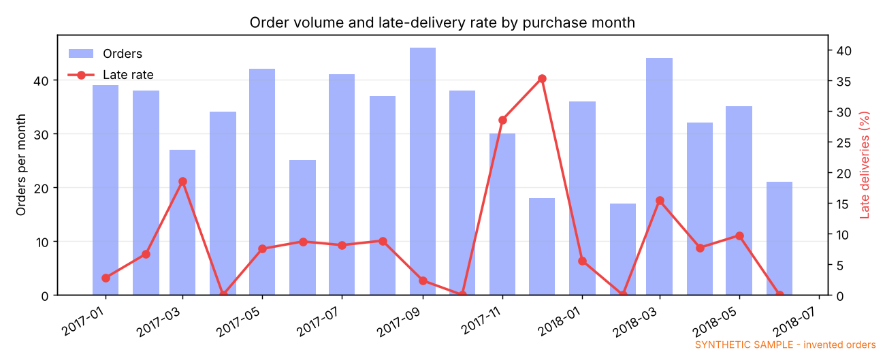

# 📦 E-Commerce Delivery Analytics

> **Question:** How often do Olist deliveries arrive late, and how much does lateness hurt review scores?

| | |
|---|---|
| **Audience** | Students practising SQL joins and aggregations on real multi-table data |
| **Time** | ~60 minutes |
| **Output** | DuckDB `order_facts` table, monthly volume + late-rate chart, reviews by lateness, naive-vs-correct comparison |
| **Data** | Brazilian E-Commerce by Olist (Kaggle), CC BY-NC-SA 4.0 — not redistributed here |



## ⚠️ The trap this pack teaches
An order can have several items and several reviews. `orders JOIN items JOIN reviews` turns one order into many rows, so `count(*)` over-counts orders and averages get weighted by item count. The fix: **document each table's grain, aggregate children to one row per order first, then join**, and check `count(distinct order_id)` after every join.

## Get the real data (once)
The dataset is free but needs a Kaggle account, and its license forbids redistribution here.
1. Open https://www.kaggle.com/datasets/olistbr/brazilian-ecommerce and click **Download** (`archive.zip`).
2. Either upload the ZIP on this pack's page in the web app, or run `python load_data.py --import path/to/archive.zip`.
   Alternative: `pip install kagglehub` and `python load_data.py --fetch` (it may ask you to sign in).

## Run it

**Bash**
```bash
cd packs/kaggle-olist-delivery
python3 -m venv .venv && source .venv/bin/activate
pip install -r requirements.txt
python analysis.py --mode sample
python load_data.py --import ~/Downloads/archive.zip
python analysis.py --mode real
jupyter lab starter.ipynb
```

**PowerShell**
```powershell
cd packs\kaggle-olist-delivery
py -3.12 -m venv .venv; .\.venv\Scripts\Activate.ps1
pip install -r requirements.txt
python analysis.py --mode sample
python load_data.py --import $HOME\Downloads\archive.zip
python analysis.py --mode real
jupyter lab starter.ipynb
```

## Dataset card
- **Publisher:** Olist (Brazilian marketplace integrator), via Kaggle
- **Official source:** https://www.kaggle.com/datasets/olistbr/brazilian-ecommerce
- **Citation:** Olist and André Sionek (2018). *Brazilian E-Commerce Public Dataset by Olist*. Kaggle.
- **License:** CC BY-NC-SA 4.0 — non-commercial, share-alike, attribution. Charts you publish should credit Olist and carry the same license.
- **Version:** Kaggle dataset (2016–2018 orders); `data/raw/source.json` stores file hashes and import date
- **Known limitations:** anonymised; reviews can repeat per order; data thins out at the start and end of the period; estimated dates have no time component.

## Extension challenges
1. **Late rate by state** — join customers. *Outcome:* ranked chart with order counts.
2. **Predict late delivery** — features known at purchase time. *Outcome:* ROC AUC on a time-based holdout.
3. **Seller scorecard** — aggregate to seller grain. *Outcome:* a table that counts each order once per seller.
