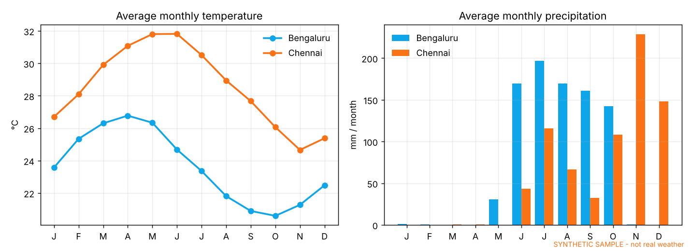

# 🌦️ Bengaluru Weather Explorer

> **Question:** What does a decade of Bengaluru weather look like, and how hard is tomorrow's temperature to predict?

| | |
|---|---|
| **Audience** | Beginners who want to work with a real scientific API |
| **Time** | ~40 minutes |
| **Output** | Monthly temperature + precipitation charts, missing-data summary, city comparison, next-day baselines |
| **Data** | NASA POWER Daily API — no key required |



## ⚠️ The trap this pack teaches
POWER marks missing values with **-999**. Average that into a month and Bengaluru suddenly has a −40 °C March. The loader converts the fill value to `NaN`, and incomplete months are excluded from rainfall totals. POWER also returns **gridded estimates** for the coordinates you request — so every result records latitude, longitude, units, time standard (LST) and the fill value.

## Run it

**Bash**
```bash
cd packs/nasa-bengaluru-weather
python3 -m venv .venv && source .venv/bin/activate
pip install -r requirements.txt
python analysis.py --mode sample
python analysis.py --mode real --param city=bengaluru --param compare_city=chennai \
  --param start=2015-01-01 --param end=2024-12-31
jupyter lab starter.ipynb
```

**PowerShell**
```powershell
cd packs\nasa-bengaluru-weather
py -3.12 -m venv .venv; .\.venv\Scripts\Activate.ps1
pip install -r requirements.txt
python analysis.py --mode sample
python analysis.py --mode real --param city=bengaluru --param compare_city=chennai --param start=2015-01-01 --param end=2024-12-31
jupyter lab starter.ipynb
```

Pre-fetch only: `python load_data.py --fetch --city chennai --start 2015-01-01 --end 2024-12-31`.

## Dataset card
- **Publisher:** NASA Langley Research Center — Prediction Of Worldwide Energy Resources (POWER)
- **Official source:** https://power.larc.nasa.gov/docs/services/api/temporal/daily/
- **Citation:** *Data obtained from the NASA Langley Research Center (LaRC) POWER Project funded through the NASA Earth Science/Applied Science Program.*
- **Terms:** NASA open data; acknowledgement requested — see https://power.larc.nasa.gov/docs/referencing/
- **Version:** live API — the query URL, API version and retrieval time are saved in `data/raw/*.source.json`
- **Known limitations:** coarse grid (a whole city is one cell); recent days may be provisional and revised; precipitation is a model/satellite product, not a rain gauge.

## Extension challenges
1. **Bengaluru vs. Chennai** — same method, same range. *Outcome:* comparison chart + a paragraph on SW vs. NE monsoon.
2. **Beat the baselines** — linear model on recent days + seasonal terms. *Outcome:* MAE below persistence and climatology.
3. **Warming trend** — fetch 1985–2024. *Outcome:* °C/decade with a caveat about gridded data.
