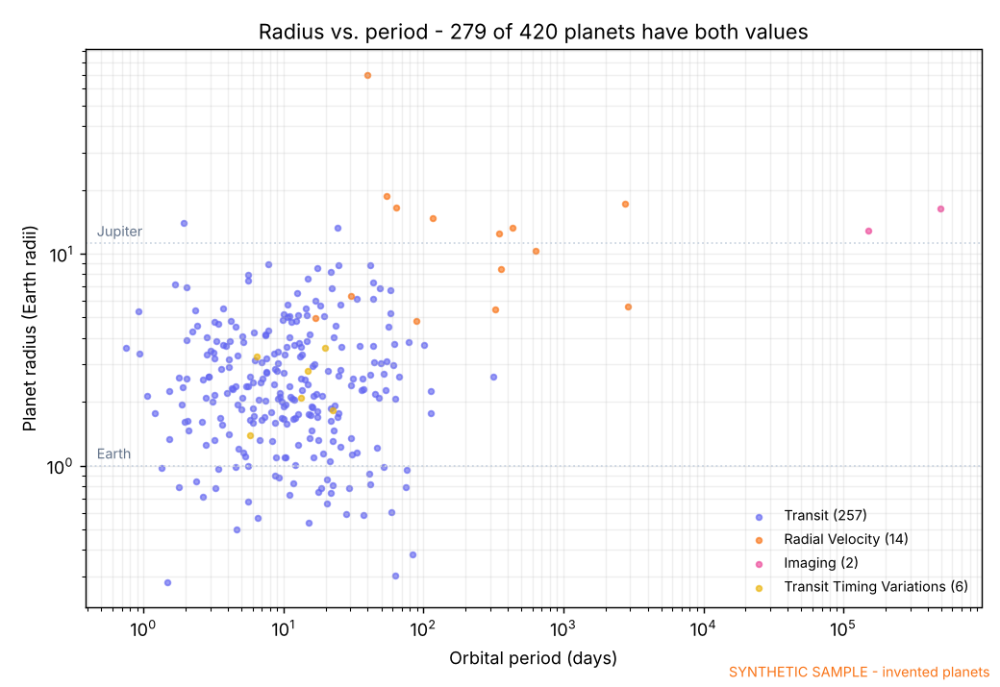

# 🪐 Exoplanet Discovery Explorer

> **Question:** How have exoplanet discoveries changed over time, and what does each detection method let us see?

| | |
|---|---|
| **Audience** | Space-curious students learning why a catalog is not a census |
| **Time** | ~50 minutes |
| **Output** | Discoveries-by-method chart, radius-vs-period scatter, missingness summary, method-prediction baseline |
| **Data** | NASA Exoplanet Archive TAP, table `pscomppars`, DOI 10.26133/NEA13 |



## ⚠️ The trap this pack teaches
Each detection method has its own bias. Filtering to "planets with a radius" silently removes most radial-velocity and microlensing planets, so the scatter plot shows the transit survey, not the galaxy. The notebook reports missingness on the **full** catalog before filtering and states in the chart title how many planets were plotted.

## Run it

**Bash**
```bash
cd packs/nasa-exoplanets
python3 -m venv .venv && source .venv/bin/activate
pip install -r requirements.txt
python analysis.py --mode sample
python load_data.py --fetch     # live TAP query, records query + retrieval date
python analysis.py --mode real
jupyter lab starter.ipynb
```

**PowerShell**
```powershell
cd packs\nasa-exoplanets
py -3.12 -m venv .venv; .\.venv\Scripts\Activate.ps1
pip install -r requirements.txt
python analysis.py --mode sample
python load_data.py --fetch
python analysis.py --mode real
jupyter lab starter.ipynb
```

## Dataset card
- **Publisher:** NASA Exoplanet Archive, operated by Caltech/IPAC (NExScI) under contract with NASA
- **Official source:** https://exoplanetarchive.ipac.caltech.edu/ — TAP endpoint `https://exoplanetarchive.ipac.caltech.edu/TAP/sync`
- **Citation:** NASA Exoplanet Archive, *Planetary Systems Composite Parameters*, doi:10.26133/NEA13 — include your access date
- **Terms:** see the archive's acknowledgement page; credit the archive and DOI in anything you publish
- **Version:** live table, updated weekly — `data/raw/source.json` stores the query and retrieval time
- **Known limitations:** composite rows mix references; masses may be M·sin i; strong observational selection effects.

## Extension challenges
1. **Habitable-zone shortlist** — add `pl_eqt`, `st_teff`. *Outcome:* a candidate table with a sentence about bias.
2. **Mass–radius relation** — fit log mass vs. log radius. *Outcome:* slopes either side of 1.5 R⊕.
3. **Facility timeline** — group by `disc_facility`. *Outcome:* the Kepler → TESS hand-off on one chart.
