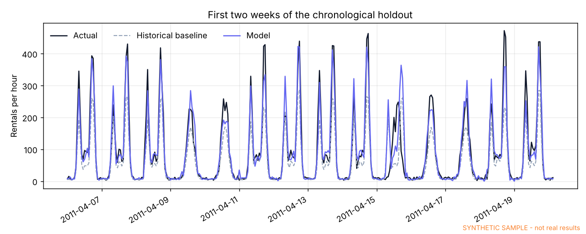

# 🚲 Bike Demand Forecast

> **Question:** How accurately can we estimate next-hour rental demand?

| | |
|---|---|
| **Audience** | Students who know basic pandas and want their first honest forecasting project |
| **Time** | ~45 minutes |
| **Output** | Hourly demand profile, holdout chart, MAE: historical baseline vs. gradient boosting |
| **Data** | UCI Bike Sharing (`hour.csv`), CC BY 4.0 |



## ⚠️ The trap this pack teaches
`casual + registered = cnt`. If either column is a feature, the model just adds them up and reports a near-perfect score that is useless in practice. Weather columns are **observations**, not forecasts — so to predict hour *t* we only use weather observed in hour *t − 1*. Finally, the file skips some hours, so lags are computed on a complete hourly grid instead of by shifting rows.

## Run it

**Bash (Linux/macOS)**
```bash
cd packs/uci-bike-demand
python3 -m venv .venv && source .venv/bin/activate
pip install -r requirements.txt
python analysis.py --mode sample          # synthetic fixture, no download
python load_data.py --fetch               # download the real data (~300 KB)
python analysis.py --mode real            # real holdout result
jupyter lab starter.ipynb
```

**PowerShell (Windows)**
```powershell
cd packs\uci-bike-demand
py -3.12 -m venv .venv; .\.venv\Scripts\Activate.ps1
pip install -r requirements.txt
python analysis.py --mode sample
python load_data.py --fetch
python analysis.py --mode real
jupyter lab starter.ipynb
```

Outputs land in `outputs/<mode>/` (`results.json` + PNG charts). Sample results are watermarked **SYNTHETIC SAMPLE**.

## What's inside
| File | Purpose |
|---|---|
| `starter.ipynb` | Load → validate → explore → baseline → model → evaluate → limitations |
| `load_data.py` | Sample/real loader, download with timeout, cache + `data/raw/source.json` provenance |
| `analysis.py` | Same steps as the notebook, as a script (used by the web app and CI) |
| `data-dictionary.md` | Grain, keys, units, target and excluded columns |
| `fixtures/` | Invented data with the real schema, including missing hours |
| `tests/` | Schema, leakage and time-split regression tests |

## Dataset card
- **Publisher:** UCI Machine Learning Repository — data from Capital Bikeshare, Washington D.C., 2011–2012
- **Official source:** https://archive.ics.uci.edu/dataset/275/bike+sharing+dataset
- **Citation:** Fanaee-T, H. (2013). Bike Sharing [Dataset]. UCI Machine Learning Repository. https://doi.org/10.24432/C5W894
- **License:** CC BY 4.0 — credit the source when you publish charts or derived data
- **Version:** the static UCI archive; `data/raw/source.json` records the SHA-256 and retrieval date
- **Known limitations:** two years from one city; weather is normalised; some hours are absent; 2012 demand is much higher than 2011 (system growth), so a random split would look better than reality.

## Extension challenges
1. **Add a second model** — try `RandomForestRegressor` or a Poisson GLM. *Outcome:* a third holdout MAE in the results table.
2. **Forecast 24 hours ahead** — remove the 1- and 2-hour lags. *Outcome:* a chart of MAE vs. horizon.
3. **Prediction intervals** — fit quantile models for p10/p90. *Outcome:* the coverage rate on the holdout.
