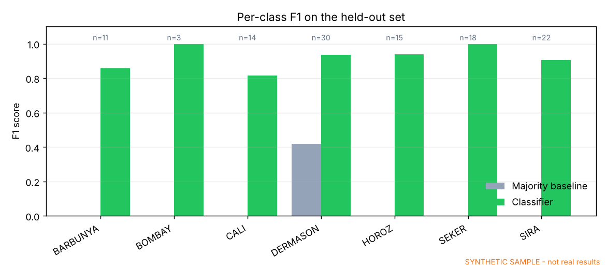

# 🫘 Dry Bean Classifier

> **Question:** Can we tell seven dry bean varieties apart from shape measurements alone — for every variety, not just the common ones?

| | |
|---|---|
| **Audience** | Students building their first honest classifier |
| **Time** | ~40 minutes |
| **Output** | Majority baseline, classifier, confusion matrix, macro F1 and per-class results |
| **Data** | UCI Dry Bean Dataset, CC BY 4.0 |



## ⚠️ The trap this pack teaches
Overall accuracy can look fine while one variety fails. A "classifier" that always says DERMASON already scores about 26 % accuracy but a macro F1 near zero. This pack uses a **stratified split** (so rare BOMBAY beans are evaluated), reports **macro F1 and per-class scores**, and keeps the scaler **inside a pipeline** so it is fit on training data only.

## Run it

**Bash**
```bash
cd packs/uci-dry-bean
python3 -m venv .venv && source .venv/bin/activate
pip install -r requirements.txt
python analysis.py --mode sample
python load_data.py --fetch                 # 4.5 MB ZIP, reads the .xlsx with openpyxl
python analysis.py --mode real --param model=random_forest
jupyter lab starter.ipynb
```

**PowerShell**
```powershell
cd packs\uci-dry-bean
py -3.12 -m venv .venv; .\.venv\Scripts\Activate.ps1
pip install -r requirements.txt
python analysis.py --mode sample
python load_data.py --fetch
python analysis.py --mode real --param model=random_forest
jupyter lab starter.ipynb
```

## Dataset card
- **Publisher:** UCI Machine Learning Repository; images and features by Koklu & Ozkan (2020)
- **Official source:** https://archive.ics.uci.edu/dataset/602/dry+bean+dataset
- **Citation:** Dry Bean [Dataset]. (2020). UCI Machine Learning Repository. https://doi.org/10.24432/C50S4B
- **License:** CC BY 4.0
- **Version:** static UCI archive; `data/raw/source.json` stores the SHA-256 and retrieval date
- **Known limitations:** one imaging setup; features only (no images); highly correlated features; SIRA/DERMASON overlap.

## Extension challenges
1. **Fix SIRA vs. DERMASON** — *Outcome:* higher F1 for both in the confusion matrix.
2. **Cross-validated comparison** — `StratifiedKFold(5)` across three models. *Outcome:* mean ± std macro F1.
3. **Permutation importance** — *Outcome:* a ranked chart and a note on correlated features.
